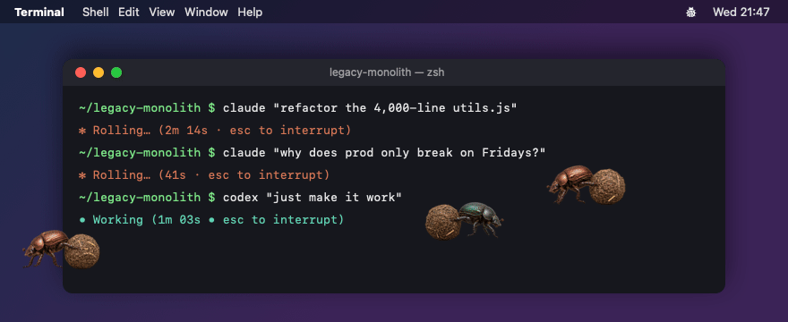

# Token Rollers

> Somebody has to roll it.



<sub>Three busy sessions, sped up. The terminal is staged; the beetles are not.</sub>

Every day you hand your coding agents the stuff nobody else wants to touch: the 4,000-line
`utils.js`, the migration that "should only take a minute", the ticket that just says *make it
work*. Claude Code and Codex quietly pack it into a neat ball and push it somewhere better.

**Stercorarius**, the macOS menu-bar app in this repository, finally gives them some credit.
While an agent session is working, a dung beetle rolls its ball across your screen: one beetle
per busy session. When the session goes idle, its beetle fades out and goes home.

- **One beetle:** an agent is earning its tokens.
- **Five beetles:** congratulations, you are a manager now.
- **Ten beetles:** drink some water and ask yourself whether "just one more agent" was wise.
- **No beetles:** everyone is done, or you forgot to trust the Codex hooks.

The copper beetle works for Claude Code, the dark green one for Codex. Neither will tell you
what is in the ball.

## Why dung beetles?

Dung beetles roll loads many times their own weight, some of them steer by the Milky Way, and
not one of them has ever asked for clearer requirements. The app is named after *Geotrupes
stercorarius*, the dor beetle. Like the real thing, our beetles walk backwards and push with
their hind legs. Respect the craft.

## How it works

- **Claude Code** keeps a registry of running sessions in `~/.claude/sessions/<pid>.json`, with a
  `status` of `busy`, `idle` or `waiting`. Stercorarius reads it once a second and never writes to
  `~/.claude`.
- **Codex** runs desktop threads and TUI sessions inside shared app-server processes, so
  Stercorarius registers Codex hooks: `UserPromptSubmit` runs `'…/Stercorarius' codex-hook busy`;
  `Stop`, `Interrupt` and `SessionEnd` run `'…/Stercorarius' codex-hook idle`. The hook keeps one
  file per working session in `~/.stercorarius/codex/`.
- Each working session gets a beetle. It fades in at a random point, heading a random way, then
  crosses a random display at a random height: left to right, then mirrored right to left. It
  stays above all windows on every Space and lets clicks through. When the session stops
  working, its beetle fades out.

## Requirements

- macOS 15 or later, which also ships the `jq` and `trash` that the scripts use.
- Xcode or a Swift 6 toolchain to build.
- For `make lint` only: SwiftLint, shellcheck and shfmt (`brew install swiftlint shellcheck shfmt`).

## Install

```sh
make install
```

This builds `Stercorarius.app` into `~/Applications`, appends four hooks to `~/.codex/hooks.json`
(after saving a backup next to it), and starts the app. Then, once:

1. Trust the hooks: start `codex` and accept "Hooks need review" (or run `/hooks`), or open
   ChatGPT.app > Settings > Hooks.
2. Restart Codex sessions and ChatGPT.app; threads that are already loaded keep their old hooks.

Stercorarius does not start at login; open it from `~/Applications`. The menu-bar ladybug shows
how many sessions are working, sets the beetle size (50% by default, 75% or 100%), and quits the
app.

## Uninstall

```sh
make uninstall
```

Quits the app, removes its hooks from `~/.codex/hooks.json` (with a backup), and moves the app and
`~/.stercorarius` to the Trash. Restart Codex sessions and ChatGPT.app afterwards: threads that are
already loaded keep calling the removed hooks.

## Sprites

`Sources/Stercorarius/Resources/Sprites` holds the sprite pack; its `README.md` and
`preview.html` describe it. Each agent has a PNG atlas plus TexturePacker-style JSON
(`claude-code.*`, `chatgpt-codex.*`): frame rectangles, per-frame `durationMs` and
`renderOffsetPx`, the `animations.move_right` frame order, and `meta.pixelRatio`. Frames show
rightward travel; leftward passes mirror them. To change a beetle, replace its two files and run
`make install`.

## Development

```sh
make build   # debug build, warnings are errors
make test    # Swift tests and installer checks
make lint    # swiftlint, swift format, shellcheck, shfmt
make app     # .build/Stercorarius.app
swift run Stercorarius
```

The design is written up in `docs/superpowers/specs/2026-11-04-stercorarius-design.md`.

## FAQ

**Is this a comment on the quality of my codebase?**
The beetles are far too professional to say.

**Do the beetles slow anything down?**
No. Core Animation moves them in the render server, and the app wakes up once a second to read a
handful of tiny JSON files. The Codex hook adds a few tens of milliseconds to each prompt.

**Can my other agents get beetles too?**
Only Claude Code and Codex for now. Everyone else will have to roll their own.

## Known limitations

- A Codex turn that ends in an API error (rate or usage limit) fires no hook; its beetle keeps
  walking until that thread's next `Stop`, `Interrupt` or `SessionEnd`.
- If another Codex `Stop` hook blocks and the turn continues, the beetle leaves early.
- Claude Code's session registry format is undocumented; an update may need a decoder change.
- Codex threads loaded before installation do not run the new hooks until restarted.

## License

[MIT](LICENSE) © 2026 BeeCrow LLC, beetle sprites included.
