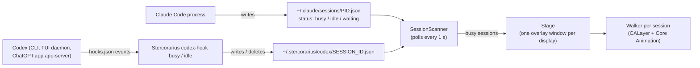

# Stercorarius — design

Date: 2026-11-04. Status: design approved in chat; this document is the written spec.

## Goal

A lightweight native macOS menu-bar app. While a Claude Code or OpenAI Codex session is working on
a turn, one animated dung beetle per session rolls its ball across the screen above all windows.
It fades in at a random point, heading a random way, then keeps crossing: left to right, then
mirrored right to left, each pass on a random display at a random height. When the turn ends,
that session's beetle fades out.

*Geotrupes stercorarius* is the dor beetle, a dung beetle — hence the name.

## Non-goals

- No interaction: sprites are click-through, carry no labels, and cannot be clicked.
- No autostart at login, no settings window (the menu offers only the beetle size), no sprite
  hot-reload.
- No agents other than Claude Code and Codex.

## Architecture



## Session detection

A session is *working* while its record says `status == "busy"` and its PID is alive (see Liveness).

### Claude Code: native session registry (read-only)

Claude Code keeps one file per running process at `~/.claude/sessions/<pid>.json`. The directory is
documented; the JSON schema is not. Fields used: `pid` (integer) and `status` (`busy`, `idle`,
or `waiting`).

- `busy` means working. `waiting` (blocked on a permission prompt) and `idle` mean not working.
- Interrupting a turn (Esc) flips `status` to `idle` within about 10 ms. Claude's `Stop` hook does not
  fire on interrupts, which is why Claude is not tracked through hooks.
- The app never writes to `~/.claude`. It reads only `*.json`; the same directory holds secret
  `*.key` files that must not be read.

### Codex: hooks writing state files

Codex desktop threads (ChatGPT.app) and Codex TUI sessions run inside shared, long-lived
`codex app-server` processes, so processes alone cannot tell sessions apart. Codex hooks
(`hooks` feature, stable and enabled) can. `make install` registers:

| Codex event | Command | Effect |
| --- | --- | --- |
| `UserPromptSubmit` | `<app>/Contents/MacOS/Stercorarius codex-hook busy` | write `~/.stercorarius/codex/<session_id>.json` |
| `Stop`, `Interrupt`, `SessionEnd` | `<app>/Contents/MacOS/Stercorarius codex-hook idle` | delete that file |

`<app>` is the absolute path of the installed bundle, `~/Applications/Stercorarius.app`.

The `codex-hook` subcommand lives in the app binary:

1. Reads the hook JSON from stdin and uses `session_id`, `cwd`, and `agent_id`.
2. Ignores payloads that carry `agent_id`: subagent turns reuse the root `session_id`.
3. Ignores Codex's internal memory-consolidation session (`cwd` equals `$CODEX_HOME/memories`,
   default `~/.codex/memories`). It fires `UserPromptSubmit` but never `Stop`.
4. Accepts only a `session_id` matching `^[A-Za-z0-9_-]{1,128}$`, so it is safe as a file name.
5. `busy`: walks up at most 8 levels from its parent process to the nearest ancestor whose executable
   name starts with `codex`, then atomically writes `{"pid": <that pid>, "status": "busy"}`. If no
   such ancestor exists, it writes nothing.
6. `idle`: deletes the session's file if present.
7. On every run, deletes files in its state directory whose PID is no longer alive.
8. Never prints to stdout and always exits 0. Codex injects `UserPromptSubmit` stdout into the model
   context, and exit code 2 would block the user's prompt. Diagnostics go to stderr.

The Codex record format is the subset of Claude's registry format that the scanner reads, so one
decoder handles both directories.

### Liveness

A PID counts as alive for an agent when `proc_pidpath` succeeds for it and the executable path
contains the agent name (`claude` or `codex`, case-insensitive). This rejects dead PIDs and PIDs
reused by unrelated processes without parsing process start times. It matches every install seen on
this machine: `…/claude-code-darwin-arm64/claude`, `…/claude-code/bin/claude.exe`,
`~/.local/share/claude/versions/<version>`, the bun-installed native `codex`,
`~/.codex/packages/app-server-daemon/…/codex`, and `ChatGPT.app/…/codex-cli/…/codex`.

### Polling

The app scans both directories once per second. A missing directory means no sessions.

## Rendering

- **Stage.** One overlay window per display, created on demand and ordered out while it has no
  walkers. Each window is a borderless `NSWindow` with a clear background, no shadow,
  `ignoresMouseEvents = true`, level `.screenSaver`, and `collectionBehavior` of
  `[.canJoinAllSpaces, .stationary, .fullScreenAuxiliary, .ignoresCycle]`, so it stays above every
  window on every Space, full-screen apps included. All overlays are rebuilt on
  `NSApplication.didChangeScreenParametersNotification`, and walkers restart their current pass.
- **Walker.** One `CALayer` per working session, sized to the sprite times the chosen beetle size
  (see Sprites).
  - Frames: a `CAKeyframeAnimation` on `contents` with `calculationMode = .discrete`, per-frame
    durations from the sprite metadata, repeating forever.
  - Movement: a linear `CABasicAnimation` on `position` at 100 pt/s.
  - The render server runs both animations, so the app does no per-frame work.
- **Passes.** Each pass picks a random display and a random height that keeps the sprite inside
  that display's `visibleFrame`, which excludes the menu bar and the Dock. A pass runs from fully
  past one edge to fully past the other; directions alternate. Leftward passes mirror the layer
  (`scaleX = -1`) and keep the frame order, so beetle and ball are mirrored together.
- **Starting.** A new walker begins at a random point of its first pass, in a random direction, and
  fades in over 0.3 s. Its walk cycle starts at a random phase. Beetles that start together, such
  as when the app launches during several busy sessions, therefore do not move in step.
- **Ending.** When its session stops working, the walker fades out over 0.3 s and is removed. A
  session that starts working again gets a new walker.

## Sprites

The user's pack `beetle-agents-realistic` is stored unchanged, including its README and
`preview.html`, in `Sources/Stercorarius/Resources/Sprites/`. Claude uses `claude-code.{png,json}`;
Codex uses `chatgpt-codex.{png,json}`.

- Metadata is a TexturePacker-style hash:
  - `frames[name].frame {x, y, w, h}`: pixel rectangles with a top-left origin.
  - `frames[name].durationMs` and `frames[name].renderOffsetPx {x, y}`.
  - `animations.move_right.frames`: playback order.
  - `meta.pixelRatio`: 2.
- Loading:
  - Crop each frame from the atlas using its explicit rectangle. The atlas is not an integer grid,
    so frames cannot be found by dividing its width.
  - Bake `renderOffsetPx` into each frame by drawing it into a transparent frame-sized bitmap shifted
    by the offset (positive y moves the art down). This keeps the ball on a steady ground line.
  - Native size is frame pixels ÷ `pixelRatio` = 221 pt, which is 1 atlas pixel per Retina pixel.
- Beetles are drawn at 50% (default), 75% or 100% of the native size. The menu's Beetle Size
  submenu sets it for all beetles at once, and the choice is saved in user defaults
  (`beetleScale`). Downscaled frames use trilinear filtering.
- If a sprite resource is missing or invalid, the app shows an alert with the error and quits.

## App shell

- Accessory app (`LSUIElement`), so no Dock icon. Its menu-bar item (SF Symbol `ladybug.fill`) shows
  a disabled status line `Claude N · Codex M`, the Beetle Size submenu, and a `Quit` item.
- Swift 6 with AppKit, QuartzCore, and ImageIO; no third-party dependencies; macOS 15+.
- A SwiftPM package. The `.app` is assembled by a script, following the sibling project Stone.

## Install and uninstall

`make install`:

1. Builds in release mode, assembles `Stercorarius.app` (signed with a Developer ID identity if one
   exists, otherwise ad-hoc), and copies it into `~/Applications/`.
2. Edits `$CODEX_HOME/hooks.json` (default `~/.codex/hooks.json`) with `/usr/bin/jq`:
   - Backs the file up to `hooks.json.stercorarius-<timestamp>.bak` before any change.
   - Touches only the `.hooks.<Event>` arrays and never adds other top-level keys. Codex rejects
     the entire file if it has an unknown top-level key, which would also disable Superset's hooks.
   - Appends its groups at the end of each array. Codex trust keys depend on array position, so
     inserting earlier would send existing trusted hooks back to review.
   - Is idempotent: if all four commands are already present, the file stays byte-identical.
   - Writes a temp file, validates it with `jq`, then moves it over the original.
3. Launches the app and prints the manual steps:
   - Trust the hooks once, via the Codex TUI review dialog or `/hooks`, or ChatGPT.app
     Settings → Hooks.
   - Restart Codex sessions and ChatGPT.app; threads that are already loaded do not pick up new
     hooks.

`make uninstall`:

- Quits the app.
- Removes Stercorarius handlers, and any groups or arrays left empty, from `hooks.json` after taking
  a backup.
- Moves the app and `~/.stercorarius` to the Trash.

`~/.claude` is never modified.

## Testing

- Swift Testing unit tests:
  - Scanner: busy, idle, waiting, malformed JSON, dead PID, ignored non-`.json` files.
  - `codex-hook`: filters, `session_id` validation, atomic write, idle delete, dead-entry cleanup,
    exit code.
  - Process helpers: executable path and parent lookup.
  - Sprite loader: a synthetic atlas with a known offset, plus the real bundled pack.
  - Pass planner geometry (including a random start point) and keyframe timing.
  - Beetle size: default, saved choice, unknown saved value, menu titles.
- A shell test runs the hooks installer against fixture `hooks.json` files in a temporary
  `CODEX_HOME`. It checks:
  - groups are appended at the end and existing groups and keys are untouched;
  - a second install is byte-identical;
  - uninstall round-trips to the original;
  - a missing file is handled.
- Lint with zero warnings: `swift build` with warnings as errors, `swiftlint --strict`,
  `swift format lint --strict`, `shellcheck`, `shfmt -d`.
- Manual end-to-end checks:
  - Launch the app while a Claude session is busy and capture a screenshot.
  - Run `codex exec` with session-level hooks (`-c` overrides plus
    `--dangerously-bypass-hook-trust`). A beetle should appear and leave after `Stop`.

## Known limitations

- A Codex turn that ends in an API error (rate limit, usage limit) fires no hook. Its beetle keeps
  walking until that thread's next `Stop`, `Interrupt`, or `SessionEnd`.
- If another Codex `Stop` hook blocks and the turn continues, the beetle leaves early.
- Claude's registry schema is undocumented, so a Claude Code update may require adjusting one
  decoder.
- Codex threads loaded before installation do not run the new hooks until they are restarted.

## Project layout

```text
Package.swift
Makefile
README.md
Support/Info.plist
Scripts/build-app.sh          # assemble and sign .build/Stercorarius.app
Scripts/codex-hooks.sh        # install | uninstall Codex hooks
Scripts/test-codex-hooks.sh   # installer tests on fixtures
Sources/Stercorarius/
  main.swift                  # `codex-hook` subcommand or app launch
  AppDelegate.swift           # status item, 1 s poll, wiring
  Agent.swift                 # agent enum, record decoding
  SessionScanner.swift
  CodexHook.swift
  Processes.swift             # proc_pidpath, parent lookup, liveness
  SpriteSheet.swift
  PassPlanner.swift
  Stage.swift                 # overlay windows per display
  Walker.swift
  Resources/Sprites/          # user's sprite pack, unchanged
Tests/StercorariusTests/
docs/superpowers/specs/
```
